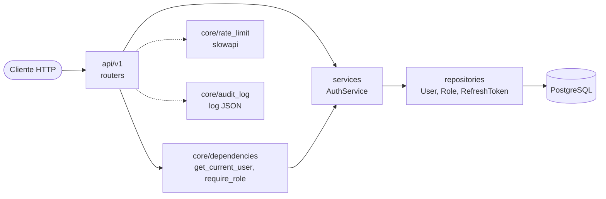

# auth-service-python

Servicio de autenticación y autorización (JWT + RBAC) escrito en Python con FastAPI y
PostgreSQL, como proyecto backend. Este proyecto fue hecho con fines de aprendizaje y
para profundizar en técnicas de diseño y seguridad: TDD, patrones de diseño, y las buenas
prácticas de OWASP y de los RFC de OAuth 2.0.

## Qué hace

-Registro y login de usuarios. Las contraseñas se guardan hasheadas con Argon2id.
-Sesiones con un access token JWT de vida corta (15 minutos) y un refresh token
opaco (7 días) que rota en cada uso. Si alguien reutiliza un refresh token ya usado, se
cierran todas las sesiones del usuario.
-Logout que revoca el refresh token de esa sesión.
-RBAC con dos roles, admin y user . Los endpoints se protegen con una dependency,
require_role(...) . Quien se registra recibe user .
-Rate limiting en /login (5 intentos por minuto por IP) y log estructurado en JSON de
cada intento de login, éxito o fallo.
-Un comando para crear al primer admin. No hay ningún endpoint para volverse
admin, a propósito.

## Requisitos

-Python 3.12
-Docker y Docker Compose (para PostgreSQL 16)

## Uso rápido

```bash
git clone https://github.com/ZalagaAF/auth-service-python.git
cd auth-service-python
python3 -m venv .venv
source .venv/bin/activate
pip install -r requirements.txt
cp .env.example .env # Editá .env: poné tu contraseña de PostgreSQL y generá una JWT_SECRET_KEY
docker compose up -d# PostgreSQL en 127.0.0.1:5433
alembic upgrade head# crea las tablas y siembra los roles admin y u
uvicorn app.main:app --reload
```

Con el servidor corriendo, abrí http://127.0.0.1:8000/docs para probar la API desde el
navegador (el botón Authorize acepta el access_token ), o directo con curl:
```bash
# 1. Registrarse
curl -X POST http://127.0.0.1:8000/api/v1/auth/register \
  -H "Content-Type: application/json" \
  -d '{"username":"ana","email":"ana@example.com","password":"Clave-segura-123"}'

# 2. Iniciar sesión: devuelve access_token y refresh_token
curl -X POST http://127.0.0.1:8000/api/v1/auth/login \
  -H "Content-Type: application/json" \
  -d '{"email":"ana@example.com","password":"Clave-segura-123"}'

# 3. Ver el propio perfil con el access token
curl http://127.0.0.1:8000/api/v1/users/me \
  -H "Authorization: Bearer <ACCESS_TOKEN>"

# 4. Renovar la sesión (no necesita el access token)
curl -X POST http://127.0.0.1:8000/api/v1/auth/refresh \
  -H "Content-Type: application/json" \
  -d '{"refresh_token":"<REFRESH_TOKEN>"}'

# 5. Cerrar sesión
curl -X POST http://127.0.0.1:8000/api/v1/auth/logout \
  -H "Content-Type: application/json" \
  -d '{"refresh_token":"<REFRESH_TOKEN>"}'
```
### Variables de entorno

Se leen del archivo `.env` (o del entorno).

| Variable                      | Default       | Descripción                                              |
|-------------------------------|---------------|----------------------------------------------------------|
| `POSTGRES_USER`               | —             | Usuario de la base de datos                               |
| `POSTGRES_PASSWORD`           | —             | Contraseña de la base de datos                            |
| `POSTGRES_DB`                 | —             | Nombre de la base. Los tests usan `<POSTGRES_DB>_test`    |
| `POSTGRES_HOST`               | `127.0.0.1`   | Host de PostgreSQL                                        |
| `POSTGRES_PORT`               | `5432`        | Puerto. Con el `docker-compose.yml` del proyecto es `5433` |
| `JWT_SECRET_KEY`              | —             | Clave de firma de los JWT, de al menos 32 caracteres      |
| `JWT_ALGORITHM`               | `HS256`       | Algoritmo de firma                                        |
| `ACCESS_TOKEN_EXPIRE_MINUTES` | `15`          | Vida del access token                                     |
| `REFRESH_TOKEN_EXPIRE_DAYS`   | `7`           | Vida del refresh token                                    |

Para generar una `JWT_SECRET_KEY`:

```bash
python -c "import secrets; print(secrets.token_urlsafe(48))"
```

## Endpoints

| Método | Path                       | Descripción                                                          |
|--------|----------------------------|----------------------------------------------------------------------|
| POST   | `/api/v1/auth/register`    | Crea una cuenta con rol `user`. Body: `username` (3–50), `email`, `password` (8–128). Responde 201 |
| POST   | `/api/v1/auth/login`       | Body: `email`, `password`. Devuelve `access_token` y `refresh_token`. Límite: 5 por minuto por IP |
| POST   | `/api/v1/auth/refresh`     | Body: `refresh_token`. Devuelve un par nuevo y revoca el usado. No pide cabecera `Authorization` |
| POST   | `/api/v1/auth/logout`      | Body: `refresh_token`. Revoca ese token. Responde siempre 204        |
| GET    | `/api/v1/users/me`         | Perfil del usuario autenticado, con sus roles                        |
| GET    | `/api/v1/users`            | Solo `admin`. Lista paginada: `?limit=` (1–100, por defecto 20) y `?offset=` (por defecto 0) |
| GET    | `/health`                  | `{"status": "ok"}`                                                   |

Las rutas protegidas esperan `Authorization: Bearer <access_token>`.

### Respuestas de error

| Código | Cuándo                                                                                   |
|--------|-------------------------------------------------------------------------------------------|
| 401    | Credenciales o token inválidos. El cuerpo es siempre el mismo, sin importar el motivo      |
| 403    | Autenticado, pero sin el rol que pide el endpoint                                          |
| 409    | El usuario o el email ya están registrados                                                 |
| 422    | El pedido no cumple el formato (email inválido, contraseña corta, paginación fuera de rango) |
| 429    | Demasiados intentos de login. Incluye la cabecera `Retry-After`                            |

## Arquitectura



```
app/
├── main.py                  # crea la app, registra routers y el rate limiter
├── api/v1/                  # routers: auth.py, users.py
├── core/                    # config, security (hash y JWT), dependencies,
│                            # exceptions, roles, rate_limit, audit_log, logging_config
├── db/                      # base declarativa y sesión
├── models/                  # User, Role, user_roles, RefreshToken
├── repositories/            # acceso a datos: users, roles, refresh tokens
├── schemas/                 # modelos de entrada y salida (pydantic)
├── services/                # AuthService: las reglas de negocio
└── scripts/create_admin.py  # comando para crear al primer admin
alembic/                     # migraciones (esquema y seed de roles)
tests/{unit,integration}/
```

## Tests

```bash
pytest
```
Necesita PostgreSQL levantado (`docker compose up -d`). Los tests usan una
base separada, `<POSTGRES_DB>_test`, y el fixture se niega a correr contra
cualquier base cuyo nombre no termine en `_test`.

El proyecto tiene 299 tests: unitarios (hash, JWT, configuración, esquemas,
formateador de logs) e integración (repositorios, endpoints, migración de
modelos, rate limiting, y recorridos completos de punta a punta como
registro, login, acceso protegido, refresh y logout). Se ejecutan en unos
pocos segundos.

## Posibles mejoras futuras (no implementadas)

- Contadores del rate limiter en Redis y límite adicional por cuenta
- Ventana de gracia en la detección de reutilización
- Refresh token en cookie `HttpOnly`
- Tarea de limpieza de refresh tokens vencidos
- Firmar el hash del email con HMAC y una clave secreta
- Registrar en el log de auditoría el registro, el refresh, el logout y los
  cambios de rol
- Paginación por cursor
- Cerrar sesión en todos los dispositivos y quitar roles
- Probar las migraciones en CI contra una base descartable